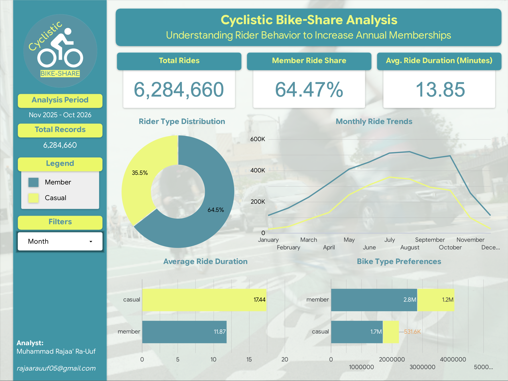
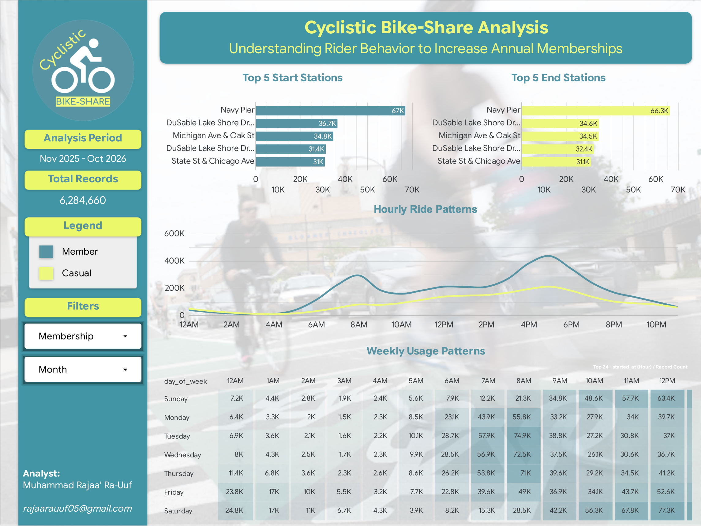

# Cyclistic Bike-Share Analysis

## Project Overview

This project analyzes Cyclistic's bike-sharing data to identify differences in riding behavior between annual members and casual riders. The analysis aims to uncover usage patterns, understand customer behavior, and provide data-driven insights that can help Cyclistic develop strategies to convert casual riders into annual members.

The project follows an end-to-end data analysis process, including data collection, data cleaning, data processing, exploratory data analysis (EDA), and data visualization.

## Business Task

Cyclistic wants to understand how annual members and casual riders use its bike-sharing services differently.

The main business question is:

**How do annual members and casual riders use Cyclistic bikes differently?**

The findings will help the marketing team develop targeted strategies to encourage casual riders to purchase annual memberships.

## Tools & Technologies

- **Google BigQuery:** Data storage, data cleaning, data processing, and SQL analysis.
- **SQL:** Data transformation, aggregation, and exploratory data analysis.
- **Google Data Studio (Formerly Looker):** Interactive dashboard development and data visualization.
- **GitHub:** Project documentation and version control.

## Data Analysis Process

### 1. Data Collection

The analysis uses Cyclistic historical bike-sharing trip data. The datasets contain information about individual rides, including ride IDs, bike types, start and end timestamps, station information, geographic coordinates, and rider classifications.

### 2. Data Cleaning & Preparation

The raw datasets were combined and processed using SQL in Google BigQuery.

The preparation process included:
- Combining monthly datasets.
- Reviewing data types and data consistency.
- Identifying and handling missing values.
- Removing invalid or irrelevant records.
- Creating additional columns to support further analysis.

### 3. Data Analysis

SQL queries were used to explore differences between annual members and casual riders, focusing on:

- Monthly riding patterns.
- Daily riding behavior.
- Hourly riding patterns.
- Ride duration.
- Bike type preferences.
- Differences in usage between member and casual riders.

### 4. Data Visualization

The processed data was visualized using Google Data Studio to create an interactive dashboard that highlights key findings and riding behavior patterns.

## Dashboard Preview

**Explore the interactive dashboard by clicking the preview below.**

[](https://datastudio.google.com/reporting/80b1cea4-4b84-440b-a8dd-93ec5a39c4c7)

[](https://datastudio.google.com/reporting/80b1cea4-4b84-440b-a8dd-93ec5a39c4c7)

[**View Interactive Dashboard on Looker Studio →**](https://datastudio.google.com/reporting/80b1cea4-4b84-440b-a8dd-93ec5a39c4c7)

## Repository Structure

```text
cyclistic-bike-share-analysis/
│
├── README.md
│
├── images/
│   ├── dashboard_page_1.png
│   └── dashboard_page_2.png
│
└── SQL/
    ├── 01_data_combination.sql
    ├── 02_data_cleaning.sql
    ├── 03_data_exploration.sql
    ├── ...
    └── 11_visualization_table.sql
```

## Key Findings

The analysis explores how annual members and casual riders differ in their usage patterns, including their preferred riding days, hours, months, ride durations, and bike types.

These insights provide a foundation for identifying opportunities to improve customer engagement and increase annual membership conversions.

## Conclusion

This project demonstrates an end-to-end data analytics workflow, from preparing raw datasets to analyzing customer behavior and presenting insights through an interactive dashboard.

By understanding the differences between casual riders and annual members, Cyclistic can develop more targeted marketing strategies and make data-driven business decisions.

---

**Project:** Cyclistic Bike-Share Analysis  
**Tools:** SQL | Google BigQuery | Google Data Studio | GitHub

*This project demonstrates an end-to-end data analytics workflow, including data preparation, SQL analysis, data visualization, and business recommendations.*
